# FastWave.AXERA

**AX650 上的通用音频超分：6–48 kHz → 48 kHz。C++ 全链路 RTF 10.97（8 步）/ 5.51（4 步），Python SDK RTF 10.96 / 5.49；单 axmodel 11.9 MB，Python/C++ SDK 即取即用。**

   

- HuggingFace: https://huggingface.co/HY-2012/FastWave.AXERA
- GitHub: https://github.com/ZY-2012/FastWave.AXERA
- 上游: https://github.com/Nikait/FastWave

## 目录

- 快速开始
- 结果
- 推理速度
- 模型转换
- 数据来源
- License

## 快速开始（AX650 板端）

从 HuggingFace 下载 `models/`、`bin/`、`python/`、`samples/`，在包根目录运行：

```bash
# C++（默认）
bash run_ax650.sh samples/listen/8k/OSR_us_000_0010_input_8k.wav output.wav

# Python SDK
bash run_ax650.sh samples/listen/8k/OSR_us_000_0010_input_8k.wav output.wav --python

# 4 步采样（更快）/ 打开后置降噪
bash run_ax650.sh samples/listen/16k/speech_2_input_16k.wav output.wav --steps 4
bash run_ax650.sh samples/listen/8k/OSR_cn_000_0072_input_8k.wav output.wav --denoise
```

输入支持 6–48 kHz，输出固定 48 kHz。

## 结果

### 8 kHz 输入（Open Speech Repository）

| 版本 | 输入 | FastWave.AXERA 输出 |
|---|---|---|
| **OSR_us_000_0010** | [▶](https://cdn.jsdelivr.net/gh/ZY-2012/FastWave.AXERA@main/samples/listen/8k/OSR_us_000_0010_input_8k.wav)<br>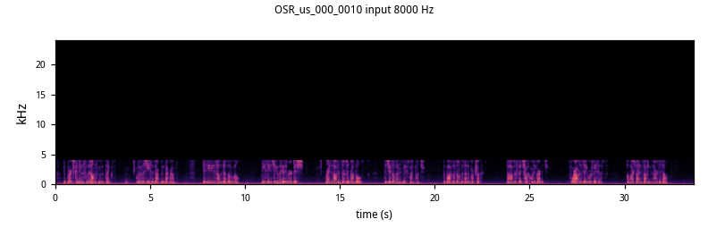 | [▶](https://cdn.jsdelivr.net/gh/ZY-2012/FastWave.AXERA@main/samples/listen/48k_from8k/OSR_us_000_0010_output_48k.wav)<br>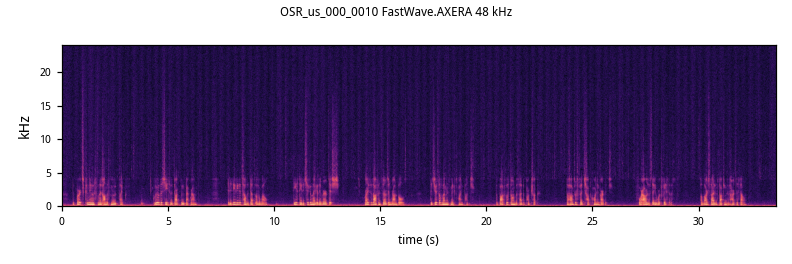 |
| **OSR_us_000_0013** | [▶](https://cdn.jsdelivr.net/gh/ZY-2012/FastWave.AXERA@main/samples/listen/8k/OSR_us_000_0013_input_8k.wav)<br>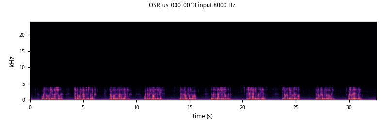 | [▶](https://cdn.jsdelivr.net/gh/ZY-2012/FastWave.AXERA@main/samples/listen/48k_from8k/OSR_us_000_0013_output_48k.wav)<br>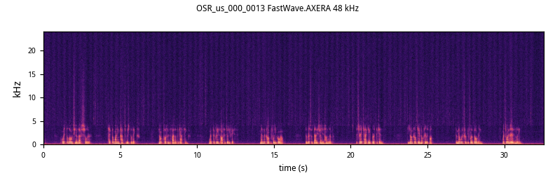 |
| **OSR_cn_000_0072** | [▶](https://cdn.jsdelivr.net/gh/ZY-2012/FastWave.AXERA@main/samples/listen/8k/OSR_cn_000_0072_input_8k.wav)<br>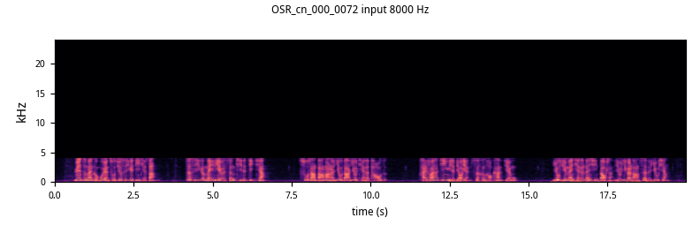 | [▶](https://cdn.jsdelivr.net/gh/ZY-2012/FastWave.AXERA@main/samples/listen/48k_from8k/OSR_cn_000_0072_output_48k.wav)<br>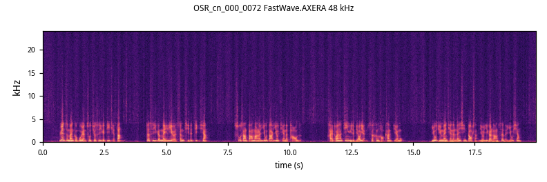 |
| **OSR_cn_000_0074** | [▶](https://cdn.jsdelivr.net/gh/ZY-2012/FastWave.AXERA@main/samples/listen/8k/OSR_cn_000_0074_input_8k.wav)<br>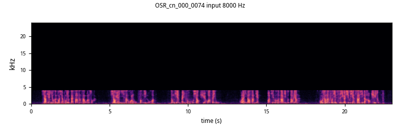 | [▶](https://cdn.jsdelivr.net/gh/ZY-2012/FastWave.AXERA@main/samples/listen/48k_from8k/OSR_cn_000_0074_output_48k.wav)<br>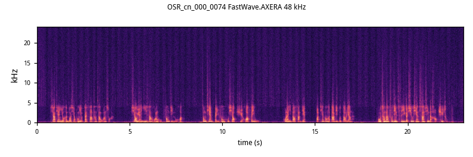 |

### 16 kHz 输入（人声）

| 版本 | 输入 | FastWave.AXERA 输出 |
|---|---|---|
| **speech_2** | [▶](https://cdn.jsdelivr.net/gh/ZY-2012/FastWave.AXERA@main/samples/listen/16k/speech_2_input_16k.wav)<br>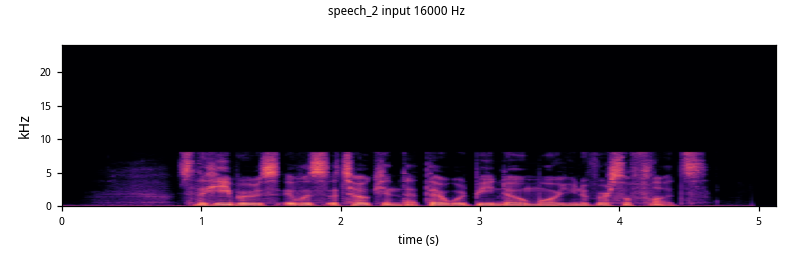 | [▶](https://cdn.jsdelivr.net/gh/ZY-2012/FastWave.AXERA@main/samples/listen/48k_from16k/speech_2_output_48k.wav)<br>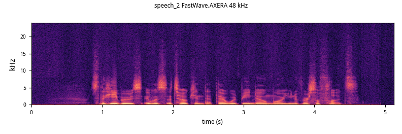 |
| **speech_3** | [▶](https://cdn.jsdelivr.net/gh/ZY-2012/FastWave.AXERA@main/samples/listen/16k/speech_3_input_16k.wav)<br>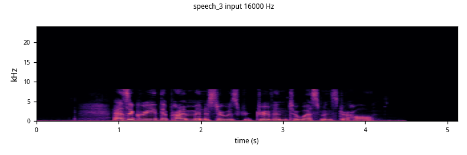 | [▶](https://cdn.jsdelivr.net/gh/ZY-2012/FastWave.AXERA@main/samples/listen/48k_from16k/speech_3_output_48k.wav)<br>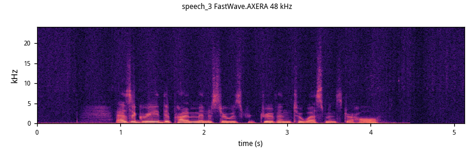 |

### 8k → 48k 频谱对比（上：输入，下：输出）

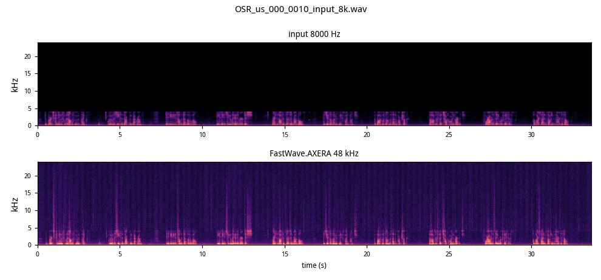

## 推理速度：RTF

AX650（NPU3，BSP V3.10.2），chunk 32768 点（0.68 s）：

| 链路 | 8 步 | 4 步 | 无重叠（8 步） |
|---|---:|---:|---:|
| C++ | 10.97 | 5.51 | 6.29 |
| Python SDK | 10.96 | 5.49 | — |

## 模型转换

```bash
python model_convert/export_onnx.py --ckpt origin/checkpoint-epoch140.pth --out export/model.onnx
python model_convert/make_calib.py --wav-dir calib/wav48 --out-dir calib/data
python model_convert/prepare_compile.py
bash model_convert/compile.sh
```

详见 `model_convert/README.md`（Pulsar2 8.0，U16 激活 / S8 权重 / U16 输出）。

## 数据来源

- Open Speech Repository（English / Chinese 8k）：http://voiptroubleshooter.com/open_speech/index.html
- 16 kHz 参照：公开人声样例经 48k → 16k 降采样
- 上游模型权重：Nikait/FastWave（MIT）

## License

Apache-2.0。`model_convert/baseline_model.py` 来自上游 FastWave（MIT）。
